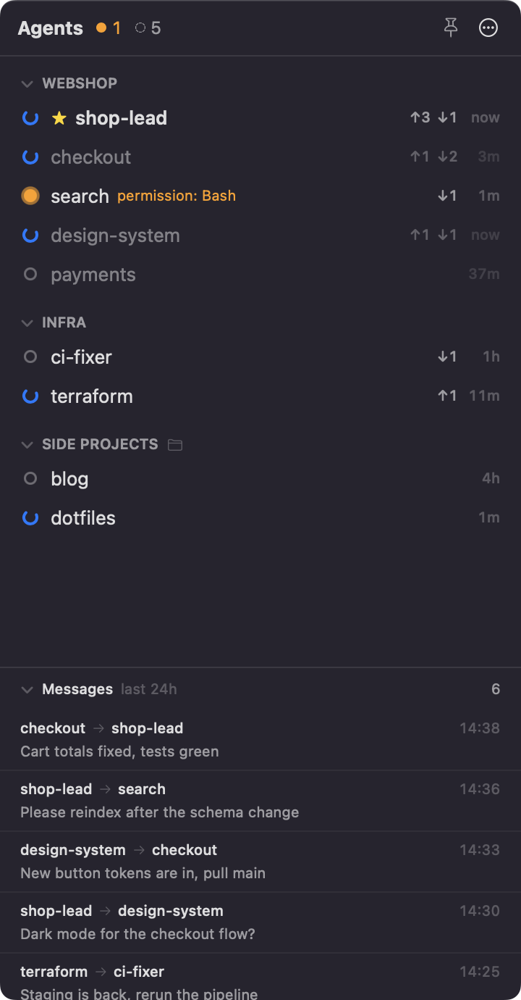
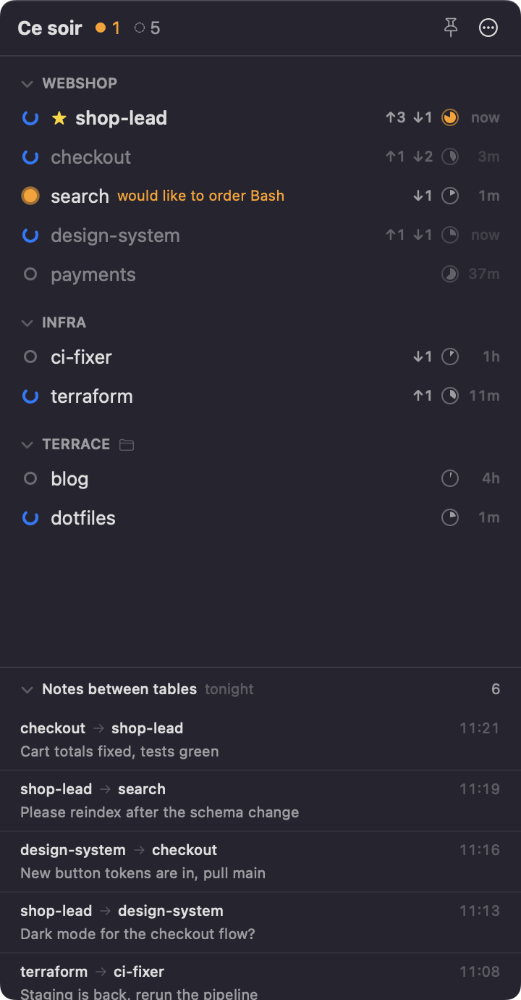

# Maître d'Agént

*Every patron is named Claude. Maître d'Agént knows which one needs you.*

A small macOS menu-bar app for anyone running several Claude Code sessions in parallel. It shows them all in one panel, grouped by repo, with one status each: **needs you**, **working** or **idle**. It also shows the messages agents send each other.

<p align="center">
  
  &nbsp;&nbsp;
  
</p>

## Features

- **Status at a glance**: orange means a session is waiting on you (permission prompt, question, plan approval), blue means it's working, grey means idle. The menu bar shows how many need you and how many are working.
- **Grouping**: sessions are grouped by git repo automatically, and worktrees join their main repo. Make your own groups and drag agents between them.
- **Manual order**: drag agents and groups into the order you want. The order survives restarts.
- **Lead agents**: if one agent per project coordinates the others, mark it as lead. It moves to the top with a ★ and the rest of its group fades slightly. Agents that need you never fade.
- **Agents can flag you**: an agent runs `maitre-d flag "Approve: …"` when it needs your decision. A lead can flag on behalf of another agent; the flag then shows on the lead's row. See [Flags](#flags).
- **Remote Control**: sessions with Remote Control on show an antenna icon next to their name.
- **Context window**: a small pie per agent shows how full its context is, and turns orange from 70% so you know when to compact. Hover for exact token counts.
- **Agent-to-agent messages**: each agent shows how many `SendMessage` messages it sent and received in the last 24h (↑ sent ↓ received). A feed lists them; click one for the full text.
- **Jump to the session**: click an agent to bring it to the front. For VS Code sessions, its window comes forward and its Claude tab opens. For Terminal.app, the exact tab is selected. For other terminals, the app comes to the front.
- **Notifications** when an agent starts needing you.
- **Pin** the panel to keep it floating on top, or let it drop down from the menu bar. A pinned panel stays on the desktop you pinned it on; on other desktops the menu bar icon opens the usual drop-down.
- **Pretentious mode**: the same app, narrated by a French maître d'. Patrons wave, dine and digest, and pass notes between tables. Toggle it in the ⋯ menu.

## Requirements

- macOS 14 or later
- Apple's Command Line Tools (`xcode-select --install`). Full Xcode isn't needed.
- [Claude Code](https://claude.com/claude-code). Sessions from the VS Code extension and from any terminal both work. Jumping to the exact tab works for VS Code and Terminal.app. The first time you click a Terminal session, macOS asks whether Maître d'Agént may control Terminal.

## Install

```sh
git clone https://github.com/robinheerich/maitre-d-agent.git
cd maitre-d-agent
./scripts/install.sh
```

This builds the app, copies it to `~/Applications/MaitreDAgent.app`, installs the Claude Code hooks and launches it. Because it's built on your own Mac, macOS doesn't show a Gatekeeper warning.

**The installer edits `~/.claude/settings.json`.** It adds hooks that run `~/.maitre-d-agent/hook.sh` and a permission rule for the flag command, installs the `maitre-d` skill in `~/.claude/skills/`, and first saves a backup as `settings.json.maitre-d-agent-backup-<timestamp>`. Sessions that were already running may need a restart before they use the new hooks.

To update, `git pull` and run `./scripts/install.sh` again. To remove the app, its hooks and its data, run `./scripts/uninstall.sh`.

## How it works

Everything is read from local files. The app makes no network requests.

| What | Where it comes from |
|---|---|
| Remote Control | The registry's `bridgeSessionId`, which Claude Code sets while Remote Control is on |
| Running sessions, names, working/idle | `~/.claude/sessions/<pid>.json`, the session registry Claude Code maintains |
| Needs you | Marker files written by `~/.maitre-d-agent/hook.sh` on `PermissionRequest`, `AskUserQuestion` and `ExitPlanMode`, and removed when the session continues. Also the registry's `waiting` status. |
| Messages | `SendMessage` tool calls in the session transcripts, `~/.claude/projects/*/<session>.jsonl` |
| Context window | Token usage of the latest API response in the transcript (`input + cache_creation + cache_read`). The window size isn't recorded, so it's inferred: 1M for `[1m]` models, model families that default to 1M, or sessions already past 200k; otherwise 200k. |
| Flags | Files in `~/.maitre-d-agent/flags/` written by `maitre-d flag`. Your prompts are recognised in the transcripts (`origin.kind: human`) to clear them. |
| Groups | The git common dir of each session's working directory |

Your groups, leads, order and settings are stored in `~/.maitre-d-agent/config.json`. Leads and order are keyed by repo plus session name, so they carry over when you restart or resume a session. Giving agents names (`/rename`) makes this work best.

**Caveat:** the session registry is an undocumented Claude Code internal. If an update changes it, parsing lives in one file, [`Sources.swift`](Sources/MaitreDAgent/Sources.swift).

## Flags

Agents can ask for your attention even when they aren't blocked on a prompt. The installer adds a small command and a [Claude Code skill](https://docs.claude.com/en/docs/claude-code/skills) that tells sessions when and how to use it:

```sh
~/.maitre-d-agent/bin/maitre-d flag "Decide: ship the feed schema as v1?"        # flag yourself
~/.maitre-d-agent/bin/maitre-d flag --agent merchant "Approve the schema change"  # a lead flags another agent
~/.maitre-d-agent/bin/maitre-d unflag                                            # take it back
~/.maitre-d-agent/bin/maitre-d flags [--json]                                    # list open flags
```

- The command works out which session ran it, so agents never need their session ID. `--agent` takes a session name, the same names SendMessage uses.
- Open flags collect in an **inbox** at the top of the panel, newest first, with up to three lines of each message ("Show more" for the rest). Click one to jump to the agent that raised it; ✕ on hover dismisses it.
- A flag also shows on the row of the agent that raised it, with 🚩 and its message, and you get a notification.
- A flag clears when you next prompt the agent that raised it or the one it's about (messages from other agents don't count), when you dismiss it (✕ on hover or right-click), or when the agent runs `unflag`.
- If the agent that raised a flag ends, the flag stays in the inbox. Without a ref it's removed after 5 minutes.
- The installer allows `~/.maitre-d-agent/bin/maitre-d` in your Claude Code permissions so flagging never itself triggers a permission prompt, and puts the skill in `~/.claude/skills/maitre-d/`. Uninstalling removes both.

### Connecting other tools

Other tools, such as a task board, can mirror flags and clear them:

- `maitre-d flag --ref <ref> "…"` attaches an opaque reference, for example `board:task-42`. Maître d'Agént stores it but never interprets it. A flag with a ref stays open after its sessions end. It clears only when the human prompts the raising or flagged agent, dismisses it, or something runs `unflag`.
- `maitre-d unflag --id <id>` (repeatable) or `maitre-d unflag --ref <ref>` clears flags from anywhere, also outside a Claude session.
- Open flags are JSON files in `~/.maitre-d-agent/flags/<id>.json`, one per flag. Read them directly, or use `maitre-d flags --json`. A flag is open exactly as long as its file exists. The format is stable:

| Field | |
|---|---|
| `id` | Flag ID, also the file name |
| `raisedBySession`, `raisedByName` | Claude Code session ID and name of the agent that ran `flag` |
| `subjectSession`, `subjectName` | The agent the flag is about; the same as the raiser unless `--agent` was used |
| `message` | Up to 300 characters |
| `createdAt` | Unix time in seconds |
| `ref` | Optional, as passed with `--ref` |

Other fields may be added later; ignore the ones you don't know.

## Usage

- Click the menu bar icon to open the panel, and 📌 to pin it.
- Click an agent to jump to it. Right-click for lead, groups, Finder and session ID.
- Drag agents onto other agents or group headers to reorder or regroup them. Drag group headers to reorder groups, or use right-click → Move Up/Down.
- In the ⋯ menu: notifications, exact-tab jumping, launch at login, pretentious mode, and installing or removing hooks.

## Development

```sh
swift build                                        # debug build
.build/debug/MaitreDAgent --dump                   # print current sessions and recent messages
.build/debug/MaitreDAgent --snapshot out.png --dark            # render the panel with live data
.build/debug/MaitreDAgent --snapshot out.png --demo --dark     # render with demo data (README screenshots)
.build/debug/MaitreDAgent --install-hooks          # or --uninstall-hooks
```

All user-facing wording, plain and pretentious, lives in [`Copy.swift`](Sources/MaitreDAgent/Copy.swift).

## License

[MIT](LICENSE).

Maître d'Agént is an independent project and is not affiliated with or endorsed by Anthropic. Claude and Claude Code are trademarks of Anthropic.
